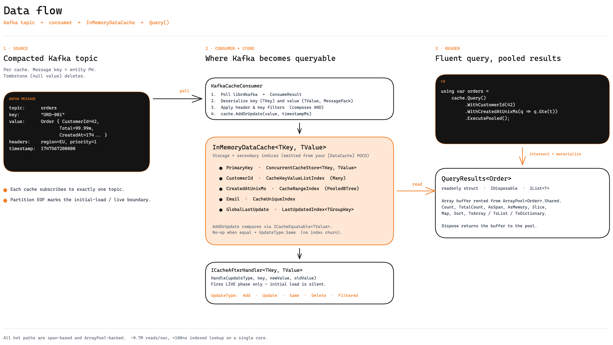
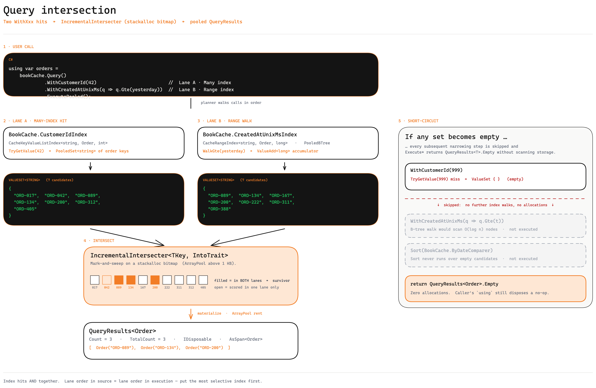

# 🏰 Prague

**The High-Performance Event Cache from Kafka's City**

Prague is a compile-time-safe, in-memory event cache for .NET. It turns `[DataCache]` POCOs fed by
event-sourced Kafka topics into typed, indexed, queryable in-process views — with a Roslyn source
generator doing the wiring, zero reflection on the read path, and pooled, zero-allocation results.

[](https://www.nuget.org/packages/Prague/)
[](LICENSE)
[](https://dotnet.microsoft.com/)

> Working with an AI assistant? Point it at [`docs/llm-readme.txt`](docs/llm-readme.txt) — a dense,
> factual description of the API, its invariants and the mistakes it should not make.

```csharp
// Define your entities with relationships — every [DataCache] type is partial.
[DataCache]
public partial class Product {
    [DataCacheKey] public int Id { get; set; }

    [DataCacheIndex(DataCacheIndexType.Range)]
    public long ReleaseDate { get; set; }

    public string Brand { get; set; }
    public bool IsPublished { get; set; }
}

[DataCache]
public partial class ProductInfo {
    [DataCacheKey] public int Id { get; set; }

    [DataCacheForeignKey<Product>(DataCacheJoinType.OneToOne)]
    public int ProductId { get; set; }

    public string Warehouse { get; set; }
}

[DataCache]
public partial class Offer {
    [DataCacheKey] public int Id { get; set; }

    [DataCacheForeignKey<Product>(DataCacheJoinType.OneToMany)]
    public int ProductId { get; set; }

    public decimal Price { get; set; }
}

// Query with joins — compile-time safe, pooled, zero-allocation results.
using var results = productCache.Query()
    .WithReleaseDate(q => q.Gte(now))            // range index
    .Where(p => p.IsPublished)                   // residual filter
    .JoinWithProductInfo()                       // 1:1 join (generated from the FK)
    .JoinWithOffer()                             // 1:N join (generated from the FK)
    .ExecutePooled();                            // rents from ArrayPool; Dispose() returns it

foreach (var row in results) {
    var product = row.Left;                      // Product
    var info    = row.Right;                     // ProductInfo? (1:1, null when missing)
    var offers  = row.Right2;                    // QueryResults<Offer> (1:N)
}
```

## 🗺️ At a glance

Kafka topic → consumer → typed `InMemoryDataCache` with secondary indices → pooled `QueryResults<T>`.
After-handlers fire on the live phase only; conditional updates (`UpdateType.Same`) suppress phantom churn.

> **Topic requirement — one partition per cache topic.** The initial-load handshake completes per cache
> on the first partition EOF, so a multi-partition cache topic goes live before the load has finished.
> Prague never creates its own topics (`AllowAutoCreateTopics = false`), so provision them with
> `--partitions 1` and `cleanup.policy=compact`. The full suggested topic configuration is in
> [`www/docs/articles/advanced/kafka-integration.md`](www/docs/articles/advanced/kafka-integration.md#creating-a-topic).



Every `WithXxx` adds a candidate-narrowing lane. The runtime intersects them on a stackalloc bitmap and
short-circuits on the first empty set — no further index walks, no allocations.



## ✨ Why Prague?

### **🚀 Extreme Performance**
- **11M+ reads/sec** with pooled queries (concurrent 3-level join, 10 readers + 2 writers; `HeavyJoinPooledBenchmarks`, see RESULTS.MD)
- **<100 ns** indexed lookups; **18 ns** for a frozen unique-key point lookup
- **0 B per execution** on pooled and frozen paths
- **3–36×** over the eager builder with `BuildFrozen()` on indexed shapes

> _Reads/sec is measured by the concurrent `HeavyJoinPooledBenchmarks` (10 reader threads + writers,
> pooled 3-level join): the count is the sum of result rows returned ÷ wall-clock seconds. All figures
> are from an Apple M4 Pro; absolute numbers vary by hardware. Every measured table lives in
> [`benchmarks/Prague.Benchmarks/RESULTS.MD`](benchmarks/Prague.Benchmarks/RESULTS.MD)._

### **🛡️ Compile-Time Safety**
- Fluent query API generated from your attributes — IntelliSense lists exactly the indices you declared
- Which verbs are reachable where (`Where`, `Sort`, `Join`, `Execute*`, inside an `Or` branch, inside a
  join filter, on a prepared builder) is enforced by the type system, not at runtime
- Type-state range builders, struct comparers, `static` lambdas — no reflection, no magic strings

### **🎯 Built for Event Sourcing**
- Conditional updates: generated deep structural equality decides `Add` / `Update` / `Same`
- Compile-time joins (1:1 and 1:N) driven by `[DataCacheForeignKey<T>]`
- Kafka consumer/producer on a raw, span-based zero-copy path; header/key/value filters; tombstones
- Global last-update index for incremental sync ("everything changed since T")

### **📊 Automatic Query Planning**
- `Unique`, `Many`, `Range` indices plus symmetric variants and predicate key-set indices
- Automatic intersection with short-circuit on the first empty lane
- Two query flavors: eager `Query()…Execute()` and prepared `Prepare()…Build()` / `BuildFrozen()`
  (plan once, bind one of three executors, execute at 0 B from any thread)

### **⚡ Modern .NET**
- Targets `net9.0` and `net10.0`; C# 14
- Source generators, `Span<T>`, `stackalloc`, `ArrayPool<T>`, static-abstract strategy structs,
  SIMD bitmap unions, lock-free readers

---

## 📦 Packages & installation

```bash
dotnet add package Prague          # facade: Core + Attributes + Codegen
dotnet add package Prague.Kafka    # Kafka consumer/producer, filters, health, OpenTelemetry
dotnet add package Prague.Api      # optional: HTTP inspection endpoints
dotnet add package Prague.Api.UI   # optional: Blazor UI over Prague.Api
```

| Package | What it is |
|---|---|
| `Prague` | Top-level facade. References `Prague.Core`, `Prague.Attributes` and `Prague.Codegen`. Add this one. |
| `Prague.Core` | Runtime: `InMemoryDataCache`, indices, query engine, prepared/frozen queries, joins. |
| `Prague.Attributes` | `[DataCache]`, `[DataCacheKey]`, `[DataCacheIndex]`, `[DataCacheForeignKey<T>]`, … |
| `Prague.Codegen` | Roslyn source generator (`netstandard2.0`, referenced as an analyzer). |
| `Prague.Kafka` | Consumer/producer on the `Nanov.Confluent.Kafka` fork, SerDe, filters, health checks, OTel. |
| `Prague.Api` / `Prague.Api.UI` | `MapPragueEndpoints()` HTTP surface over live caches, and a MudBlazor UI for it. |

Every package multi-targets `net9.0;net10.0`. Published versions are on the `0.6.0-pre.*` line.

---

## 🚀 Quick Start

### **1. Define your entity**

```csharp
using Prague.Core;

[DataCache]                                        // optional: [DataCache("OrdersCache")] to name the class
[DataCacheTopic("orders.events")]                  // optional: default template is "Cache.<ClassName>"
[DataCacheSort("ByPriority", "Priority:1", "CreatedAt:-1")]
public partial class Order {                       // must be partial
    [DataCacheKey]
    public string OrderId { get; set; }

    [DataCacheIndex(DataCacheIndexType.Many)]      // 1:N — many orders per customer
    public int CustomerId { get; set; }

    [DataCacheIndex(DataCacheIndexType.Range)]     // sorted — Gte / Lt / … queries
    public long CreatedAt { get; set; }

    [DataCacheIndex(DataCacheIndexType.Unique)]    // 1:1 — alternate key
    public string InvoiceNumber { get; set; }

    public decimal Total { get; set; }
    public int Priority { get; set; }
    public OrderStatus Status { get; set; }
}
```

**What the generator emits:** `OrderCache` (the wrapper: index fields, `Cache`, `Query()`, `Prepare()`,
`AddOrUpdate`, `TopicNameTemplate`, `ByPriorityComparer`), `Order.CacheEquals` / `CacheGetHashCode`
(deep structural equality), `Order.Clone()`, a query-string parser, and — when `Prague.Kafka` is
referenced — the enrichment and `AddOrUpdateAndProduce` / `RemoveAndProduce` helpers.

### **2. Create the cache**

```csharp
// Stand-alone (tests, in-process views)
var cache = new OrderCache();

// Or through the registry, which also wires joins and global indexes between caches
var registry = new DataCacheRegistryBuilder()
    .Register<OrderCache>()
    .Register<CustomerCache>()
    .Build();
var cache = registry.GetCache<OrderCache>();

// Or from Kafka through DI — see "Kafka integration"
services.AddKafkaCaches(o => o.BootstrapServers = "kafka:9092",
    b => b.AddCache<OrderCache, string, Order>());
```

### **3. Write**

```csharp
cache.AddOrUpdate(new Order { OrderId = "ORD-001", CustomerId = 42, /* … */ });   // timestamp = now
cache.AddOrUpdate(order, timestampMs);                                             // explicit timestamp

// Conditional update: false when the stored value is structurally equal
bool changed = cache.AddOrUpdate(sameOrder, out var previous);
```

### **4. Query**

```csharp
// One index
using var customerOrders = cache.Query()
    .WithCustomerId(42)
    .ExecutePooled();

// Several indices intersect; Where runs only on the survivors
using var recent = cache.Query()
    .WithCustomerId(42)
    .WithCreatedAt(q => q.Gte(yesterdayMs))
    .Where(o => o.Status == OrderStatus.Pending)
    .ExecutePooled();

// Sorted page — SortBounded for a page, Sort for the whole result (see "Sorted paging")
using var page = cache.Query()
    .WithCustomerId(42)
    .SortBounded(OrderCache.ByPriorityComparer)
    .ExecutePooled(skip: 0, take: 20);

Console.WriteLine($"Found {page.TotalCount} orders, showing {page.Count}");
```

`ExecutePooled()` rents from `ArrayPool` and **must be disposed** — `using var` is the idiom.
`Execute()` allocates and needs no disposal.

### **5. Direct index access**

```csharp
if (cache.InvoiceNumberIndex.TryGetValue("INV-001", out var orderId))   // Unique → TKey
    cache.Cache.TryGet(orderId, out var order);

var orderIds   = cache.CustomerIdIndex.GetValues(42);                      // Many → keys
var recentIds  = cache.CreatedAtIndex.GetValuesBetween(startMs, endMs);    // Range → keys
```

---

## 🎓 Core Concepts

### **Index types**

| Attribute | Index class | Shape | Generated query verb |
|---|---|---|---|
| `[DataCacheIndex(Unique)]` | `CacheUniqueIndex` | 1:1, O(1) | `WithXxx(value)`, `WithXxx(span / array / list)` |
| `[DataCacheIndex(Many)]` (default) | `CacheKeyValueListIndex` | 1:N, O(1) + bucket | same; a multi-value call is an OR within the lane |
| `[DataCacheIndex(Range)]` | `CacheRangeIndex` (pooled B+tree) | sorted | `WithXxx(q => q.Gte(a).Lt(b))` |
| `[DataCacheIndex(Many, Symmetric = true)]` | `CacheSymmetricKeyValueListIndex` | 1:N + reverse map | as `Many`; enables left-index-driven joins |
| `[DataCacheIndex(Unique, Symmetric = true)]` | `CacheSymmetricUniqueIndex` | 1:1 + reverse map | as `Unique` |
| `[DataCacheHasValueIndex]` / `[DataCacheHasNotValueIndex]` | `CacheKeySetIndex` | keys with non-null / null (or `true` / `false`) | `WithXxx()` / `WithoutXxx()` |
| `[DataCacheValueIndex(CompareOp, value)]` / `[DataCacheNoValueIndex(…)]` | `CacheKeySetIndex` | keys matching / not matching a constant comparison | `With{IndexName}()` / `Without{IndexName}()` |
| `[DataCacheGlobalLastUpdateIndex<TIndex>]` | `LastUpdatedIndex` | recency per group key, shared across caches | `UpdatedAfter(...)` — see below |

- A `Many` index takes an `InitialCapacity` hint for its per-key buckets: `[DataCacheIndex(Many, 4)]`.
- `[DataCacheKey]` is the primary key; `WithKey(...)` / `With{KeyProperty}(...)` narrow by it.
- **External types you don't own:** `[DataCache<ExternalDto>(nameof(ExternalDto.Id))]` on a `partial`
  class plus class-level `[DataCacheIndex(nameof(ExternalDto.CustomerId), DataCacheIndexType.Many)]`
  and the property-name forms of the other attributes.

**Range builder.** The sub-builder is type-state: open a lower bound with `Gt` / `Gte` *or* an upper
bound with `Lt` / `Lte`, then optionally close the other side. There is no `Between` and no `Or` on
it — a disjunction is written with the query-level `.Or(...)` clause.

```csharp
.WithCreatedAt(q => q.Gte(start).Lt(end))     // [start, end)
.WithCreatedAt(q => q.Gt(start).Lte(end))     // (start, end]
.WithCreatedAt(q => q.Gte(start))             // [start, ∞)
.WithCreatedAt(q => q.Lt(end))                // (-∞, end)
```

### **Query execution**

| Terminal | Allocates | Clones elements | Use |
|---|---|---|---|
| `Execute(skip, take)` | new array | no | one-off, tests |
| `ExecuteCloned(skip, take)` | new array | yes | caller mutates the rows |
| `ExecutePooled(skip, take)` | `ArrayPool` rent | no | **hot paths — `using var`** |
| `ExecutePooledCloned(skip, take)` | `ArrayPool` rent | yes | pooled + safe to mutate |
| `Count()` | none | — | matching count without materializing |

All return `QueryResults<T>`: `Count`, `TotalCount` (before paging), `Truncated`, indexer, `AsSpan()`,
`Slice`, `Sort`, `Map`, `ToArray` / `ToList` / `ToDictionary`, an implicit `ReadOnlySpan<T>` conversion
and a **ref enumerator** (`foreach (ref var x in results)` edits the backing array in place).

**Execution plan:** the first lane seeds the candidate set, every later lane intersects it on a
stackalloc bitmap, an empty intersection stops immediately, and `Where` predicates run only on the
survivors. Place the most selective index first on the eager path; the frozen path picks the seed
itself.

`UseIndex(index, value | span | list)` narrows by an index field directly — the raw
`InMemoryDataCache<TKey,TValue>` has no generated `WithXxx` and uses this form.

### **OR queries**

Disjunction is the two-branch `.Or(b1, b2)` clause. Each branch is narrowing-only; the two are unioned
and the union is intersected with the surrounding chain. Three or more branches nest.

```csharp
// (DepartmentId = 1 OR DepartmentId = 2) AND BrandId = 5
var results = cache.Query()
    .WithBrandId(5)
    .Or(b => b.WithDepartmentId(1),
        b => b.WithDepartmentId(2))
    .Execute();

// Chained WithXxx inside a branch is AND:
// (DepartmentId=1 AND BrandId=5) OR (DepartmentId=2 AND BrandId=6)
var results = cache.Query()
    .Or(b => b.WithDepartmentId(1).WithBrandId(5),
        b => b.WithDepartmentId(2).WithBrandId(6))
    .Execute();

// Zero-allocation TArg overload — static lambdas, arg shared by both branches
var args = (Dept1: 1L, Dept2: 2L);
var results = cache.Query()
    .Or(static (b, a) => b.WithDepartmentId(a.Dept1),
        static (b, a) => b.WithDepartmentId(a.Dept2),
        args)
    .Execute();
```

- Inside a branch only `WithXxx` / `UseIndex` / nested `Or` are reachable; `Where`, `Sort`, joins and
  `Execute*` are compile errors there.
- A branch that narrows nothing is excluded from the union.
- `Or` is also reachable inside a join filter callback.
- One stackalloc bitmap per `Or` level; the cross-branch merge is a SIMD `Vector<int>` OR; cost scales
  with surviving candidates, not index-result size.

### **Sorted paging — `Sort` vs `SortBounded`**

Two plans; you pick one. `[DataCacheSort("ByDate", "ReleaseDate:-1", "Id:-1")]` emits
`XxxCache.ByDateComparer` (an `IComparer<T>`); any `IComparer<T>` works, and a **struct** comparer makes
the sort allocation-free.

```csharp
// Paging — select just the page, never sort the rest
using var page = cache.Query().WithDepartmentId(1)
    .SortBounded(new ByReleaseDateDesc())
    .ExecutePooled(skip: 40, take: 20);

// Materialising everything — classic full sort
using var all = cache.Query().WithDepartmentId(1)
    .Sort(new ByReleaseDateDesc())
    .ExecutePooled();
```

| You are… | Use | Why |
|---|---|---|
| paging — `take` is a small slice of what matched | `SortBounded` | **2.3–8.6× faster**; deep pages win too |
| taking a quarter or more of what matched | `Sort` | bounded is **1.3–2.7× slower** there and rents an O(N) buffer |
| calling `Execute*()` with no page | `Sort` | unbounded always runs the classic sort |

Both plans break ties by encounter order, so consecutive pages of an unchanged result partition it;
with a *total* comparer the two return byte-identical output. Measured (Apple M4 Pro, .NET 9):

```
                        page 20 of 100k   page 200 of 10k   half the result   whole result
SortBounded                     940µs             194µs            10.3ms         16.2ms
Sort (classic)                 8066µs             449µs             7.8ms          7.6ms
```

### **Joins (foreign key relationships)**

Put `[DataCacheForeignKey<T>(joinType)]` on the property that **holds** the FK. The generator adds the
index the join needs and emits `JoinWith{T}()` / `InnerJoinWith{T}()` on the right cache's builder.

```csharp
[DataCache]
public partial class Book {
    [DataCacheKey] public int Id { get; set; }

    [DataCacheForeignKey<Author>(DataCacheJoinType.ManyToOne)]   // many books → one author
    public int AuthorId { get; set; }
}

using var rows = bookCache.Query()
    .WithAuthorId(authorId)
    .JoinWithAuthor()                 // outer: rows kept when the author is missing
    .ExecutePooled();

foreach (var row in rows)
    Console.WriteLine($"{row.Left.Title} by {row.Right?.Name ?? "unknown"}");

using var byAuthor = authorCache.Query()
    .JoinWithBook()                   // reverse direction: row.Right is QueryResults<Book>
    .ExecutePooled();
```

| Declaration | Emitted on | Result slot | Example |
|---|---|---|---|
| `OneToOne` on a scalar | both caches | `TRight?` | `ProductInfo.ProductId` → `ProductCache.JoinWithProductInfo()` and `ProductInfoCache.JoinWithProduct()` |
| `OneToMany` on a scalar | the target cache | `QueryResults<TRight>` | `Offer.ProductId` → `ProductCache.JoinWithOffer()` |
| `ManyToOne` on a scalar | both caches | forward `TRight?`, reverse `QueryResults<TRight>` | `Book.AuthorId` → `BookCache.JoinWithAuthor()` and `AuthorCache.JoinWithBook()` |
| `ManyToOne` on a `List<TKey>` | both caches | `QueryResults<TRight>` | `Doc.TagIds` → `DocCache.JoinWithTag()` and `TagCache.JoinWithDoc()` |

- **Dual form:** `[DataCacheForeignKey<Book>(OneToMany, nameof(Book.AuthorId))]` on `Author.Id` when
  you cannot annotate `Book`. **Selector form:** `[DataCacheForeignKey<T, TSelector>]` with a
  `readonly struct : IForeignKeySelector<TFk, TPk>` when the FK type differs from the target PK type
  (compound keys); `OneToOne` only, on the PK property.
- Each `JoinWith{T}` has an `InnerJoinWith{T}` twin (drops lefts with no match) and three filter
  flavors: none, a callback over the right cache's narrowing builder, and callback + user-state `TArg`
  (`static` lambda, 0 B). After `Sort` / `SortBounded` only the outer, unfiltered form binds.
- **Counting instead of materialising:** every `JoinWith{T}` whose slot is `QueryResults<TRight>` has a
  `CountJoinWith{T}` / `InnerCountJoinWith{T}` twin whose slot is an `int` — the number of rights the
  join would have delivered — with the same filter flavors. Unfiltered it reads one index bucket per
  left and nothing else (no fan-out, no child buffer, no clones); it works eager, prepared and frozen.
- Joined rows are `JoinResult<TLeft, T1, …>` with `Left`, `Right`, `Right2`, `Right3`, … A query
  chains up to 5 joins. Pooled join results rent one shared buffer and are returned by one `Dispose()`.
- Lower-level `JoinOne(...)` / `JoinMany(...)` / `CountJoin(...)` extensions exist for the raw cache;
  pass the cache wrapper, not `.Query()`.
- Caches created through `DataCacheRegistryBuilder` or `AddKafkaCaches` are joined automatically.
  Stand-alone instances need `leftCache.AddJoinedCaches(rightCache, …)` once.

### **Prepared queries — build once, execute on demand**

A prepared query is the command form of a query: describe it once, optionally with a parameter struct,
store it in a field and execute it any number of times from any thread. Every execution replays the
description into the same engine the eager builder uses, so the results are the same rows in the same
order with the same `TotalCount` / `Truncated`, and the pooled paths allocate nothing per execution.
The one allocation is `Build()`.

```csharp
public sealed class ProductSearch {
    private readonly PreparedQuery<(int dept, int brand, long since, decimal minPrice, bool inStockOnly),
                                   JoinResult<Product, ProductInfo?>> _search;

    public ProductSearch(ProductCache products) {
        _search = products.Prepare<(int dept, int brand, long since, decimal minPrice, bool inStockOnly)>()
            .Or(b => b.WithDepartmentId(static a => a.dept),     // parameterized WithXxx
                b => b.WithBrandId(static a => a.brand))
            .WithReleaseDate(static (rb, a) => rb.Gte(a.since))  // parameterized range
            .Where(static (p, in a) => p.Price >= a.minPrice)    // parameterized Where — `in a`, no closure
            .If(static a => a.inStockOnly,                       // applies only when the arg says so
                b => b.Where(static p => p.Stock > 0))
            .SortBounded(new ByReleaseDateDesc())                // struct comparer, paged
            .JoinWithProductInfo()                               // FK-generated join, unchanged
            .Build();                                            // the only allocation
    }

    public int CountPage((int dept, int brand, long since, decimal minPrice, bool inStockOnly) args) {
        using var page = _search.ExecutePooled(args, skip: 0, take: 20);   // 0 B, any thread
        return page.Count;
    }
}
```

- `Prepare()` (`TArgs = NoArgs`) and `Prepare<TArgs>()` exist on every generated cache and on the raw
  `InMemoryDataCache` (`UseIndex(index, static a => …)` instead of `WithXxx`). Every `WithXxx` /
  `WithoutXxx` / `WithKey` / `UpdatedAfter` overload has a prepared twin taking a `Func<TArgs, T>`.
- **`TArgs` must be a `struct`** — a tuple, a `readonly record struct`, a primitive, or `NoArgs`. A
  class is CS0453. Prefer `readonly`; reading a property of a non-readonly struct through `in` copies it.
- **The arg `Where` predicate takes `TArgs` by `in`**: write `static (v, in a) => …`. It is the one
  callback that runs per candidate row. Its delegate type is `ArgFilter<TValue, TArgs>`; a plain
  `(v, a) => …` does not convert (CS1676). Every other callback is an ordinary `Func<…>`.
- **`Match`** is the multi-way branch — tag form (`Match(static a => a.Mode, m => m.Case(Mode.X, b => …).Default(…))`)
  or guard form (`Match(m => m.Case(static a => a.minPrice > 0, b => …).Default())`). **Every `Match`
  ends in a `Default`** — an open chain is CS0315. `If` / `IfElse` are sugar over a one-`Case` guard `Match`.
- Inside `Or` branches: `WithXxx` / `UseIndex`, nested `Or`, narrow-only `If` / `Match`. Inside `If` /
  `Match` arms: those plus `Where`. Never inside a branch: joins, `Sort` / `SortBounded`, `Build()`.
- Prepared builders have no `Execute*`; `Build()` / `BuildFrozen()` are the only terminals. Executions
  take `in TArgs` plus `skip` / `take`: `Execute`, `ExecutePooled`, `Count` and the `*Cloned` variants.

#### **`BuildFrozen()` — the same query, planned once**

`BuildFrozen()` ends the chain where `Build()` does but plans the query once and binds it to an
executor built for that shape: a **point lookup** for a unique-index equality, a **single-pass
pipeline** for everything else it can take (one index step's keys are copied out and every other step
becomes an O(1) probe — no candidate set, no intersection; joins fuse into the pass, `Sort` /
`SortBounded` feed the top-k container directly, `Count` skips the values it does not need), and the
prepared **replay** for the rest.

```csharp
private readonly FrozenQuery<(int dept, int brand), JoinResult<Product, ProductInfo?>> _page =
    products.Prepare<(int dept, int brand)>()
        .WithDepartmentId(static a => a.dept)
        .WithBrandId(static a => a.brand)
        .SortBounded(new ByReleaseDateDesc())
        .JoinWithProductInfo()
        .BuildFrozen();                       // BuildFrozen(new FrozenOptions { … }) to tune

using var page = _page.ExecutePooled((dept, brand), skip: 0, take: 20);   // 0 B, any thread
Console.WriteLine(_page.Explain());           // the plan, the live optimizations, the last seed chosen
```

**The ordering contract.** A frozen result holds the same rows as eager, with the same `Count` /
`TotalCount` / `Truncated`, pooling, leak safety and 0 B per pooled execution. **Order is not part of
the contract unless you ask for it:** an unsorted result carries no row-order guarantee and the ties of
a sorted one are unspecified. A `Sort` / `SortBounded` with a **total** comparer is byte-identical to
eager. That freedom is what pays: the pipeline seeds from whichever index step is narrowest *for this
execution's arguments*, not the one you declared first. `new FrozenOptions { PreserveEagerOrder = true }`
restores the eager sequence at the eager cost. The other flags — `FuseFilters`, `AdaptiveFilterOrdering`,
`CapacityHints`, `Pipeline` (default on), `IndexSideProbes` (default off) — are read once at build.

Measured on the raw cache (100k rows, 1k-row list buckets, Apple M4 Pro, .NET 9, pooled + disposed;
every frozen row 0 B per execution):

| Shape | Eager | `Build()` | `BuildFrozen()` | Ratio |
|---|---:|---:|---:|---:|
| unique lookup, parameterized | 132 ns | 129 ns | **18.0 ns** | 7.3× |
| list bucket + `Where` | 8.62 µs | 8.58 µs | **5.84 µs** | 1.5× |
| list ∩ list (1k ∩ 100, largest declared first) | 9.26 µs | 9.11 µs | **1.29 µs** | 7.2× |
| list ∩ 60k-row range window | 398 µs | 396 µs | **11.2 µs** | 35× |
| `Or` of two 1k buckets, first narrowing | 976 µs | 983 µs | **26.9 µs** | 36× |
| `SortBounded` page of 20 over list ∩ list | 10.8 µs | 10.8 µs | **2.84 µs** | 3.8× |
| 3 lists → `SortBounded(page)` → `JoinOne` | 14.2 µs | 13.9 µs | **3.9 µs** | 3.6× |
| `Sort` over a 1k bucket → `JoinMany` | 118 µs | 119 µs | **14.3 µs** | 8.3× |

Design: [`docs/superpowers/specs/2026-09-09-prepared-query-command-design.md`](docs/superpowers/specs/2026-09-09-prepared-query-command-design.md),
[`docs/superpowers/specs/2026-09-09-frozen-pipeline-executor-design.md`](docs/superpowers/specs/2026-09-09-frozen-pipeline-executor-design.md);
engine notes in [`context/query.md`](context/query.md); generated surface in [`context/generated.md`](context/generated.md).

### **Conditional updates**

Every write goes through `AddOrUpdate`. The cache compares the incoming value to the resident one with
the generated `CacheEquals` (deep, property-by-property, collections included) and reports the outcome.

```csharp
bool changed = cache.AddOrUpdate(order, out var previous);   // true: Add or Update; false: Same
```

- `[DataCacheIgnoreEquality]` excludes a property (a monotonic timestamp, an audit field) from the
  comparison, so a re-emit that differs only there is `Same`.
- On `Same` nothing is swapped, no index is touched and no after-handler sees a phantom update. On a
  compacted topic that re-emits state on every rebuild, this is the difference between thousands of
  no-op `Update` events at startup and exactly the real transitions.
- The Kafka path surfaces the outcome as `UpdateType` (`Filtered`, `Same`, `Add`, `Update`, `Delete`)
  to `ICacheAfterHandler<TKey, TValue>`.
- `cache.AddOrUpdateAndProduce(order)` produces only when the local write changed something;
  `cache.AddOrUpdateAndProduce(order, force: true)` keeps the local write conditional but always
  produces, to re-publish the current state onto the topic. `cache.ForceProduceAll()` does that for
  every resident record at once — a repair tool for re-seeding a topic, not a normal write.

### **Deep cloning**

The generator emits `Clone()` for every `[DataCache]` type (recursive, collection-aware, no reflection).
`ExecuteCloned()` / `ExecutePooledCloned()` return cloned rows so you can mutate them without touching
the cache; `QueryResults<T>.CloneElements()` does the same after the fact.

### **Result mapping**

`Map` lives on `QueryResults<T>` and runs after execution. It projects into a result of the same
pooled kind and **consumes the source** (the source is disposed for you), so dispose the mapped result.

```csharp
using var totals = cache.Query()
    .WithCustomerId(42)
    .ExecutePooled(skip: 20, take: 10)
    .Map(order => new { order.OrderId, order.Total });   // TotalCount preserved

Console.WriteLine($"Showing {totals.Count} of {totals.TotalCount}");
```

### **Batch reads**

```csharp
var keys = new[] { "ORD-001", "ORD-002", "ORD-003" };

Span<Order> buffer = new Order[keys.Length];
int found = cache.Cache.TryGet(keys, buffer);              // fills the span, returns the hit count

List<Order> orders = cache.Cache.TryGet(keys);             // only the found items
List<Order> big    = cache.Cache.TryGet(keys, o => o.Total > 100m);
```

### **Global last update index**

Track the latest update per grouping key **across caches** — the primitive behind incremental sync.

```csharp
// 1. A partial class the generator completes
public partial class DepartmentLastUpdatedIndex : IDataCacheGlobalLastUpdateIndex<int>;

// 2. Mark the group key on every contributing cache
[DataCache]
public partial class CatalogProduct {
    [DataCacheKey] public string ListingId { get; set; }

    [DataCacheGlobalLastUpdateIndex<DepartmentLastUpdatedIndex>]              // timestamp from AddOrUpdate
    public int DepartmentId { get; set; }

    [DataCacheGlobalLastUpdateIndex<BrandLastUpdatedIndex>(nameof(UpdatedAt))] // or from a property
    public long BrandId { get; set; }
    public DateTimeOffset UpdatedAt { get; set; }
}

[DataCache]
public partial class Product {
    [DataCacheKey]
    [DataCacheGlobalLastUpdateIndex<ProductLastUpdatedIndex>]                 // on the PK → UpdatedAfter(...)
    public int ProductId { get; set; }
}

// 3. Resolve it (registry or DI singleton)
var departmentIndex = registry.GetGlobalIndex<DepartmentLastUpdatedIndex>();
departmentIndex.TryGetMax(out long latestMs, out int departmentId);
int count = departmentIndex.GetEntitiesCount(42);

// 4. Query — when the group key is the cache's primary key the generator emits UpdatedAfter;
//    UseIndex(globalIndex, …) is the raw-cache spelling of the same thing
using var changed = productCache.Query()
    .UpdatedAfter(lastSyncMs, out long newWatermark)     // strictly greater than lastSyncMs
    .ExecutePooled();

using var window = productCache.Cache.Query()
    .UseIndex(productIndex, startMs, endMs)
    .ExecutePooled();

// A group key that is not the PK (DepartmentId above) is read through the index itself:
// which departments changed, then query each department's rows by its own index
var changedDepartments = departmentIndex.Index.GetValuesGt(lastSyncMs);
```

`UpdatedAfter` / `UseIndex(globalIndex, …)` have `long`, `DateTime` and `DateTimeOffset` overloads, an
`(after, untilInclusive)` window form, an `out long max` form and prepared twins; they bind only when the
global index is keyed by the cache's primary key type. The filtered variant
`[DataCacheGlobalLastUpdateIndex<TIndex, TFilter>]` (a `readonly struct : IDataCacheGlobalLastUpdateFilter<T>`)
tracks only entities the filter admits, re-evaluated on every update.

### **Topics**

```csharp
[DataCacheTopic("orders.[v:env]")]          // default template without the attribute: "Cache.<ClassName>"
public partial class Order { … }

OrderCache.TopicNameTemplate                // "orders.[v:env]" — compile-time constant
```

`[v:name]` placeholders resolve against `KafkaCachesOptions.Vars` and `[e:NAME]` against environment variables at registration time; unknown names are left verbatim.

---

## 🔥 Kafka integration

```csharp
services.AddKafkaCaches(
    o => {
        o.BootstrapServers = "kafka:9092";
        o.ClientSettings["group.id"] = "my-service";      // forwarded to librdkafka
        o.Vars["env"] = "prod";                           // topic-template placeholders
    },
    b => {
        b.AddCache<OrderCache, string, Order>()                      // topic from [DataCacheTopic]
            .WithHeaderEqualsFilter("tenant", "acme")
            .WithValueFilter(static o => o.Status == OrderStatus.Active, treatAsDelete: true)
            .WithAfterHandler<OrderProjector>();
        b.AddCache<CustomerCache, int, Customer>("customers-[v:env]");  // explicit topic
        b.AddInternalCache<ViewCache, int, View>();                   // in the registry, not consumed
    });

var orders = provider.GetRequiredService<OrderCache>();
```

- One `AddKafkaCaches` call per cluster (`configsSectionName` distinguishes them). Each registers a
  hosted service whose `StartAsync` returns once every cache has reached its initial-load EOF, so an
  ASP.NET Core host does not serve before the caches are loaded. Elsewhere: `await host.DataCachesLoadCompletion()`.
- Each process consumes under its own `group.id` by default and commits no offsets, so every instance
  loads every topic in full (broadcast, not work-sharing) and a restart re-reads everything.
- **Filters** (`WithHeader*Filter`, `WithKeyFilter`, `WithValueFilter`) AND-compose and are an ingress
  gate evaluated once per message on the consume thread. Header filters run before key deserialization.
  `treatAsDelete: true` turns a rejection into a tombstone for the key. DI-aware overloads resolve
  state **once** at build (`WithKeyFilter(static sp => …snapshot…, static (state, key) => …)`).
- **Tombstones** (null value) skip the key and value filters and always delete the key. Only a header
  filter that explicitly rejected the value, or the producer self-filter, drops one.
- **After-handlers** (`ICacheAfterHandler<TKey, TValue>`) fire on the live phase only, with the
  `UpdateType`; `Filtered` carries neither key nor value.
- **Enrichment:** `[DataCacheFromTimestamp]` fills a property from the message timestamp,
  `[DataCacheHeader("tenant-id")]` from a header.

**Producer.** Registered as a keyed singleton under the section name:

```csharp
public sealed class OrderService([FromKeyedServices("kafkaCaches")] KafkaCacheProducer producer) {
    public void Place(Order o) => producer.Produce("orders", o.OrderId, o);     // upsert
    public void Cancel(string id) => producer.Delete("orders", id);             // tombstone
}

orderCache.AddOrUpdateAndProduce(order);   // writes locally; produces only when the value changed
orderCache.RemoveAndProduce(orderId);      // removes locally and publishes the tombstone
```

Fire-and-forget: `Produce` / `Delete` return once queued in librdkafka; a broker-side failure is only
logged; `acks=all` is librdkafka's default, which is why `min.insync.replicas` matters on the topic.
**A process never re-consumes its own writes** (the `X-Producer-Id` header self-filter), so prefer the
`*AndProduce` helpers over a bare `Produce` when the local cache must reflect the write.

**MessagePack isolation.** Every SerDe call goes through `PragueMessagePack.Options`; host changes to
`MessagePackSerializer.DefaultOptions` do not affect Prague's wire format. Extend the resolver chain with
`options.WithMessagePackResolver(defaultResolver => …)` on the third `AddKafkaCaches` argument.

Full guide, including the suggested topic configuration and the filter lifecycle:
[`www/docs/articles/advanced/kafka-integration.md`](www/docs/articles/advanced/kafka-integration.md).

---

## 🩺 Health checks

Split **liveness** and **readiness** `IHealthCheck` implementations for
`Microsoft.Extensions.Diagnostics.HealthChecks`. The healthy path is zero-allocation.

```csharp
services.AddHealthChecks()
    .AddPragueKafkaLiveness (tags: ["live"])    // "prague-kafka-live",  failure → Unhealthy
    .AddPragueKafkaReadiness(tags: ["ready"]);  // "prague-kafka-ready", failure → Degraded

app.MapHealthChecks("/health/live",  new HealthCheckOptions { Predicate = r => r.Tags.Contains("live") });
app.MapHealthChecks("/health/ready", new HealthCheckOptions {
    Predicate = r => r.Tags.Contains("ready"),
    ResultStatusCodes = {
        [HealthStatus.Healthy]   = StatusCodes.Status200OK,
        [HealthStatus.Degraded]  = StatusCodes.Status503ServiceUnavailable,   // default maps Degraded → 200
        [HealthStatus.Unhealthy] = StatusCodes.Status503ServiceUnavailable,
    }
});

services.Configure<KafkaCachesHealthOptions>(o => {
    o.PollLoopHeartbeatTimeout = TimeSpan.FromSeconds(3);   // default
    o.HandlerProcessingTimeout = TimeSpan.FromSeconds(5);   // default
    o.MinBrokersUp             = 1;                         // default; needs StatisticsEnabled (default on)
});
```

| Check | Predicate | Catches |
|---|---|---|
| Liveness | `FatalLatched` | fatal Kafka error; consumer unsafe |
| | `PollLoopStalled` | poll loop silent longer than `PollLoopHeartbeatTimeout` |
| | `HandlerLoopFaulted` | a per-cache worker terminated with an exception |
| | `HandlerProcessingTimeout` | one message in flight longer than `HandlerProcessingTimeout` |
| Readiness (= liveness +) | `InitialLoadIncomplete` | a cache has not reached initial-load EOF |
| | `NoPartitionAssigned` | a cache topic has zero partitions assigned |
| | `BrokersDown` | fewer than `MinBrokersUp` brokers `UP` |
| | `PartitionsLost` | last rebalance lost partitions and nothing was re-assigned |

`HealthCheckResult.Data` carries `<consumer>.failures` and `<consumer>.caches` so the output names the
culprit. Set `MinBrokersUp = 0` if you disable librdkafka statistics.

---

## 📊 OpenTelemetry metrics

Opt-in, observable (callback-based) instruments sourced from the statistics the consumer already
collects — zero hot-path cost, zero allocations per scrape after warm-up.

```csharp
services.AddOpenTelemetry().WithMetrics(m => m
    .AddPragueKafkaInstrumentation()        // → "prague.kafka.*"; AddPragueKafkaInstrumentation("acme.") to prefix
    .AddPrometheusExporter());
```

| Metric | Kind | Unit | Tags |
|---|---|---|---|
| `prague.kafka.consumer.partitions.assigned` | UpDownCounter | `{partition}` | `consumer` |
| `prague.kafka.consumer.broker.rtt.p99` | Gauge | `ms` | `consumer` |
| `prague.kafka.consumer.health` | Gauge | `0`/`1` | `consumer` |
| `prague.kafka.cache.size` | UpDownCounter | `{item}` | `consumer`, `cache` |
| `prague.kafka.cache.messages.received` | Counter | `{message}` | `consumer`, `cache` |
| `prague.kafka.cache.health` | Gauge | `0`/`1` | `consumer`, `cache` |
| `prague.kafka.cache.index.size` | UpDownCounter | `{item}` | `consumer`, `cache`, `index`, `kind=keys\|values` |

The `health` gauges follow Prometheus `up` semantics (`1` healthy) and share their predicates with the
health checks; the `/health` endpoint carries the reasons.

```promql
min by (consumer) (prague_kafka_consumer_health) == 0
```

---

## 🔎 HTTP inspection (`Prague.Api`, `Prague.Api.UI`)

```csharp
app.MapPragueEndpoints();     // GET /prague (statistics), GET /prague/{CacheName}, GET /prague/{CacheName}/{id}
builder.AddPragueUI();        // + app.MapPragueUI() — a MudBlazor front end over the same registry
```

The collection endpoint accepts the generated query-string API (`customerId=42&total>100`), the same
parser exposed on every cache as `QueryParser.StringQueryPooled(...)`.

---

## 🧵 Concurrency contract

Caches are written while queries read them — a live Kafka consumer on one side, request handlers on the
other. There is no query-time lock and no snapshot isolation, by design:

- **A query never fails because of a concurrent write.** No exception, no torn buffer.
- **A query makes no consistency promise.** A row written mid-query may be included or missed, and two
  legs of one join may disagree. Stale or short results are correct; the next query sees the write.
- Readers are lock-free (volatile-published generations with grace-period reclamation); the single
  writer per cache is the consumer thread. Value-side probes on the frozen path never return a row that
  contradicts the query.

---

## 🏗️ Architecture

**Data flow:** `[DataCache]` POCO → codegen emits `XxxCache` partial + index storage + fluent `Query()` /
`Prepare()` → at runtime `InMemoryDataCache` resolves the index plan, intersects on a stackalloc bitmap
and returns allocating or pooled results. `BuildFrozen()` plans once and binds one of three executors —
`PointLookup`, `Pipeline`, `Replay`.

```
src/
  Prague.Attributes/   Public attributes
  Prague.Codegen/      Roslyn source generator (netstandard2.0)
  Prague.Core/         Runtime: InMemoryDataCache, indexing, query execution, prepared/frozen
                       queries, joins, T4-generated combinatorial join builders
  Prague/              Top-level package facade
  Prague.Kafka/        Raw zero-copy consumer/producer, SerDe, filters, health, OTel, background worker
  Prague.Api/ Prague.Api.UI/   HTTP inspection surface + UI
tests/        NUnit per layer: Core (raw POCOs, no codegen), Generated (through codegen), Kafka
              (broker-free), Kafka.IntegrationTests (Testcontainers), Tests.Models (fixtures)
benchmarks/   BenchmarkDotNet + RESULTS.MD (every measured table)
perf/         Regression tripwire — compare.py diffs runs against perf/baseline/<machine>.json
context/      Topic-first engineering notes (indexes, query, joins, kafka, …)
www/          Public docs site (DocFX) + landing page
docs/         Design specs and plans; llm-readme.txt
```

```bash
dotnet build Prague.sln                 # warnings are errors
dotnet test  Prague.Tests.slnf          # all tests; Kafka.IntegrationTests need Docker
dotnet run -c Release -f net9.0 --project benchmarks/Prague.Benchmarks -- --inProcess --anyCategories <cat>
perf/run.sh core|sort|sim|concurrent|all
```

---

## 🧪 Testing

A cache is a plain object — no mocks, no broker needed for the data path.

```csharp
[Test]
public void Finds_orders_by_customer() {
    var cache = new OrderCache();
    cache.AddOrUpdate(new Order { OrderId = "T-1", CustomerId = 42, /* … */ });

    using var results = cache.Query().WithCustomerId(42).ExecutePooled();

    Assert.That(results.Count, Is.EqualTo(1));
}
```

For the Kafka path there is no in-memory broker substitute; Prague's own integration tests run against
Testcontainers. Give each consumer under test its own `group.id`, and remember a process does not consume
what it produced.

---

## 🆚 What Prague is — and is not

**Is:** a library, not a server. Caches live in your process; there is no network hop. Storage, indices,
joins and query builders are generated from attributes, so the plan is fixed by your call shape at
compile time and nothing is reflected over at runtime. Result sets are pooled.

**Is not:** a distributed cache (each process owns its caches; replication is the upstream log's job), a
relational database (fluent expressions over typed indices, not SQL), or an eviction cache (no TTL / LRU —
the topic's compaction is the retention policy).

What you will not find elsewhere in one package: compile-time-checked queries with automatic index
intersection, generated 1:1 / 1:N joins with pooled results, a prepared/frozen query form that executes
at 0 B and is planned once, change detection baked into every write, and a Kafka hydration path that is
zero-copy from the broker's buffer to your POCO.

---

## 📚 Documentation

- **Docs site** — [nanov.github.io/prague.net](https://nanov.github.io/prague.net/): guides at [`/docs/`](https://nanov.github.io/prague.net/docs/),
  generated [API reference](https://nanov.github.io/prague.net/docs/api/index.html), and [`/llms.txt`](https://nanov.github.io/prague.net/llms.txt) for assistants.
- **Docs site sources** — [`www/docs/`](www/docs/), organised by what you are trying to do:
  [Tutorial: Build an Order Service](www/docs/articles/tutorial/build-an-order-service.md)
  · Core concepts ([Index Types](www/docs/articles/core-concepts/index-types.md), [Query Engine](www/docs/articles/core-concepts/query-engine.md),
  [Sorted Paging](www/docs/articles/core-concepts/sorted-paging.md), [Prepared and Frozen Queries](www/docs/articles/core-concepts/prepared-queries.md),
  [Conditional Updates](www/docs/articles/core-concepts/conditional-updates.md), [Joins](www/docs/articles/core-concepts/joins.md))
  · [How-to guides](www/docs/articles/how-to/) (page an API, incremental sync, filters, after-handlers, DI hosting, HTTP inspection, testing, health and metrics)
  · [Kafka Integration](www/docs/articles/advanced/kafka-integration.md), [Global Last Update Index](www/docs/articles/advanced/global-last-update-index.md), [Performance Tuning](www/docs/articles/advanced/performance-tuning.md)
  · Explanation ([How Prague Works](www/docs/articles/explanation/architecture.md), [The Concurrency Contract](www/docs/articles/explanation/concurrency.md), [Ordering and Determinism](www/docs/articles/explanation/ordering-and-determinism.md))
  · Reference ([Attributes and Generated Code](www/docs/articles/reference/attributes.md), [Generator Diagnostics](www/docs/articles/reference/diagnostics.md), [Benchmarks](www/docs/articles/reference/benchmarks.md)).
- **Compiled samples** — [`samples/Prague.Samples/`](samples/Prague.Samples/): every code block on the docs site is a region of
  this NUnit project and runs in CI, so the docs cannot drift from the library.
- **For LLMs and coding assistants** — [`docs/llm-readme.txt`](docs/llm-readme.txt).
- **Engineering notes** (how it works inside) — [`context/`](context/): `core.md`, `indexes.md`,
  `query.md`, `joins.md`, `collections.md`, `generated.md`, `kafka.md`, `kafka-filters.md`,
  `kafka-serde.md`, `kafka-health.md`. [`CLAUDE.md`](CLAUDE.md) maps topics to files.
- **Design history** — [`docs/superpowers/specs/`](docs/superpowers/specs/) and
  [`docs/superpowers/plans/`](docs/superpowers/plans/).
- **Measurements** — [`benchmarks/Prague.Benchmarks/RESULTS.MD`](benchmarks/Prague.Benchmarks/RESULTS.MD);
  regression baseline in [`perf/README.md`](perf/README.md).

---

## 🤝 Contributing

Issues and pull requests on [github.com/nanov/prague.net](https://github.com/nanov/prague.net/issues).
Build with `dotnet build Prague.sln` (warnings are errors), test with `dotnet test Prague.Tests.slnf`.
Never hand-edit `*.generated.cs` — change the generator or the T4 template. Re-measure A/B after any
executor change; `RESULTS.MD` records the numbers.

## 📄 License

MIT — see [LICENSE](LICENSE).

## 🙏 Acknowledgments

Named after Prague, the birthplace of Franz Kafka, whose works inspired the Kafka streaming platform
that Prague integrates with. Kafka access is through the
[`Nanov.Confluent.Kafka`](https://www.nuget.org/packages/Nanov.Confluent.Kafka) fork for its raw,
span-based consume/produce APIs.

---

**Built for Kafka, Fast as Thought** 🏰
